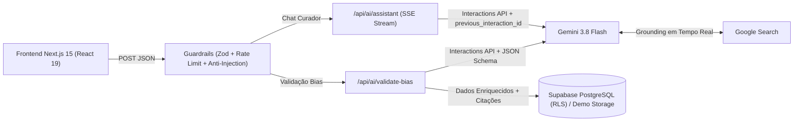

# NOCTURNE — Plataforma Editorial K-Pop & Curadoria com IA Generativa

Plataforma web full-stack voltada ao universo **K-Pop**, combinando feed editorial interativo, galeria personalizada de *biases* e **pipelines de Engenharia de IA** em produção com **Google Gemini 3.8 Flash** (`@google/genai` v2 Interactions API), **Google Search Grounding em tempo real**, **Structured Outputs**, **Streaming SSE stateful** e **Guardrails de segurança**.

> **Destaque para Portfólio / Avaliação Rápida:** O projeto conta com um **Modo Demo Instantâneo** na tela inicial, permitindo testar a Galeria, os filtros e toda a arquitetura de IA imediatamente sem precisar criar conta no banco de dados.

---

## Destaques de Engenharia de IA (AI Engineering)

Este projeto foi arquitetado aplicando boas práticas reais de sistemas baseados em LLMs:

1. **Isolamento Server-Side de Credenciais (`app/api/ai/*`)**
   - Todas as chamadas ao SDK `@google/genai` ocorrem exclusivamente no backend (Next.js Route Handlers), mantendo `GEMINI_API_KEY` protegida fora do bundle JavaScript do cliente.
2. **Grounding Factual em Tempo Real (`google_search`)**
   - LLMs puros sofrem com corte temporal de conhecimento (*knowledge cutoff*) e alucinações ao responder sobre últimos *comebacks*, paradas musicais ou mudanças de agência.
   - Tanto o pipeline de verificação de idols (`/api/ai/validate-bias`) quanto o curador conversacional (`/api/ai/assistant`) habilitam `tools: [{ type: 'google_search' }]` e extraem citações verificáveis (`url_citation`) diretamente dos *steps* da resposta.
3. **Structured Outputs Determinísticos + Dupla Validação (`JSON Schema` + `Zod`)**
   - Ao cadastrar um novo *bias*, o endpoint `/api/ai/validate-bias` força saída estruturada via `response_format` (`application/json` com JSON Schema estrito) e valida tanto a entrada quanto o payload retornado pelo modelo com **Zod**, garantindo integridade antes de persistir no PostgreSQL/Supabase.
4. **Assistente Multi-Turn Stateful com Streaming SSE (`/api/ai/assistant`)**
   - Implementa streaming em tempo real via `ReadableStream` (`text/event-stream`), emitindo estados intermediários do agente (*Analisando*, *Consultando Google Search*), deltas de texto incrementais e telemetria final (latência em ms, consumo de tokens e fontes).
   - Utiliza `previous_interaction_id` da **Interactions API** para manter memória conversacional *stateful* gerenciada no servidor, injetando dinamicamente os artistas da Galeria do usuário no `system_instruction` para recomendações personalizadas.
5. **Resiliência em Produção: Circuit Breaker & Model Cascade (`lib/ai/gemini.ts`)**
   - Chaves do plano gratuito (*Free Tier*) podem retornar `HTTP 429` especificamente para a ferramenta `google_search`. O backend implementa um **Circuit Breaker em memória** (10 min de *cooldown*) que detecta `429` em `<1s` (`maxRetries: 0`) e degrada graciosamente para `gemini-3.8-flash` direto, além de **cascata automática** para `gemini-3.5-flash-lite` em picos de taxa e otimização de latência via `thinking_level: 'low'`.
6. **Camada de Guardrails & Defesa contra Prompt Injection (`lib/ai/guardrails.ts`)**
   - **Separação de papéis:** Instruções críticas isoladas em `system_instruction`, tratando entradas do usuário estritamente como dados não confiáveis.
   - **Heurística Anti-Injection:** Bloqueio preventivo de padrões de *jailbreak* e tentativa de sobrescrita de instruções (*ignore previous instructions*, tags `<system>`, etc.).
   - **Rate Limiting:** Limitador em memória por janela deslizante (*sliding window*) por IP para proteção de cota de API.

---

## Fluxo da Arquitetura de IA



---

## Stack Tecnológica

- **Frontend:** Next.js 15 (App Router), React 19, TypeScript, Tailwind CSS v4, Motion (`motion/react`), Lucide Icons
- **IA & Orquestração:** `@google/genai` (v2 Interactions API), modelo `gemini-3.8-flash`, Google Search Grounding, JSON Schema Structured Outputs, Zod
- **Backend & Persistência:** Next.js Server Route Handlers, Supabase Auth & PostgreSQL com Row Level Security (RLS) + Fallback Local (`localStorage`) para Modo Demo

---

## Estrutura de Diretórios

```text
├── app/
│   ├── api/ai/
│   │   ├── assistant/route.ts      # Streaming SSE multi-turn + contexto da galeria + Grounding
│   │   ├── status/route.ts         # Healthcheck seguro da configuração de IA
│   │   └── validate-bias/route.ts  # Pipeline de verificação factual + Structured Outputs
│   ├── dashboard/page.tsx          # Feed editorial, Galeria, Perfil & Telemetria
│   ├── globals.css                 # Design tokens e tema neon escuro (Tailwind v4)
│   ├── layout.tsx                  # Layout raiz (PT-BR) e tipografia
│   └── page.tsx                    # Autenticação Supabase + Acesso ao Modo Demo
├── components/
│   └── ai-assistant-panel.tsx      # Interface conversacional em tempo real (Pulse IA)
├── hooks/
│   └── use-mobile.ts               # Hook responsivo para viewport mobile
├── lib/
│   ├── ai/
│   │   ├── gemini.ts               # Cliente server-only Gemini + extrator de citações
│   │   └── guardrails.ts           # Rate limiter e detecção de Prompt Injection
│   ├── demo-data.ts                # Dados iniciais e persistência do Modo Demo
│   ├── editorial-data.ts           # Conteúdo editorial estruturado e lançamentos
│   ├── supabase.ts                 # Cliente Supabase resiliente
│   └── types.ts                    # Contratos TypeScript compartilhados
└── supabase/
    └── migrations/                 # Schema SQL da tabela biases + políticas RLS
```

---

## Como Executar Localmente

### Pré-requisitos
- **Node.js** 20+ instalado
- Uma chave de API gratuita do [Google AI Studio](https://aistudio.google.com/apikey) (`GEMINI_API_KEY`)
- *(Opcional)* Projeto no [Supabase](https://supabase.com) caso queira testar autenticação real por e-mail e persistência em nuvem

### Passo a passo

1. **Instale as dependências:**
   ```bash
   npm install
   ```

2. **Configure as variáveis de ambiente:**
   Copie o arquivo `.env.example` para `.env.local`:
   ```bash
   cp .env.example .env.local
   ```
   Edite `.env.local` e adicione sua chave do Gemini (e opcionalmente o Supabase):
   ```env
   GEMINI_API_KEY=sua-chave-do-google-ai-studio

   # Opcional (o Modo Demo funciona mesmo sem configurar o Supabase)
   NEXT_PUBLIC_SUPABASE_URL=https://seu-projeto.supabase.co
   NEXT_PUBLIC_SUPABASE_ANON_KEY=sua-anon-key
   ```

3. *(Opcional)* **Configure o banco no Supabase:**
   Caso utilize o Supabase, execute o script SQL em [`supabase/migrations/20240421000000_initial_schema.sql`](supabase/migrations/20240421000000_initial_schema.sql) no **SQL Editor** do painel do Supabase para criar a tabela `biases` e ativar o **Row Level Security (RLS)**.

4. **Inicie o servidor de desenvolvimento:**
   ```bash
   npm run dev
   ```
   Acesse `http://localhost:3000`.

---

## Scripts de Qualidade e Build

```bash
npm run typecheck   # Verificação estática de tipos TypeScript
npm run lint        # Análise estática com ESLint
npm run build       # Build otimizado de produção (Next.js standalone)
```
