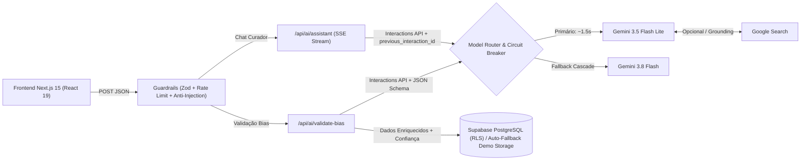

# NOCTURNE — Plataforma Editorial K-Pop & Curadoria com IA Generativa

Plataforma web full-stack voltada ao universo **K-Pop**, combinando feed editorial interativo, galeria personalizada de *biases* e **pipelines de Engenharia de IA (AI Engineering)** construídos com o SDK oficial **`@google/genai` (v2 Interactions API)**, **roteamento dinâmico de modelos (`gemini-3.5-flash-lite` & `gemini-3.8-flash`)**, **Google Search Grounding em tempo real**, **Structured Outputs**, **Streaming SSE stateful**, **Circuit Breakers de alta disponibilidade** e **Guardrails de segurança**.

> Visita Rápida:** O projeto conta com um **Modo Visitante (Demo) Instantâneo** e **auto-fallback resiliente**, permitindo testar a Galeria, os filtros e toda a arquitetura de IA imediatamente no navegador — mesmo sem criar conta ou caso a instância gratuita do Supabase esteja pausada.

---

## Principais Funcionalidades

- **Curador Conversacional "NOCTURNE Pulse IA" (`/api/ai/assistant`):** Assistente multi-turn com *Server-Sent Events (SSE)* em tempo real, injeção automática de contexto da galeria do usuário (*Context-Aware Prompting*), sugestões rápidas e telemetria ao vivo (latência em `ms`, contagem de tokens, modelo utilizado e citações clicáveis).
- **Cadastro de Bias com Verificação e Enriquecimento por IA (`/api/ai/validate-bias`):** Valida se o artista e o grupo existem realmente no cenário K-Pop, corrige grafias oficiais, preenche uma bio curta em português, sugere uma frase icônica e retorna o nível de confiança (`high`, `medium`, `low`) via **JSON Schema estrito**.
- **Feed Editorial & Radar de Comebacks:** Curadoria visual com estética *dark neon*, artigos editoriais em modal completo, filtro de artistas em alta e agenda de lançamentos.
- **Modo Visitante (Demo) com Persistência Local:** Permite adicionar, filtrar e remover *biases* com validação real da IA usando `localStorage`, sincronizado lado a lado com o fluxo autenticado via **Supabase Auth + PostgreSQL (RLS)**.

---

## Destaques de Engenharia de IA & Resiliência (AI Engineering)

Este projeto foi arquitetado aplicando padrões de produção para sistemas baseados em LLMs:

1. **Isolamento Server-Side de Credenciais (`app/api/ai/*`)**
   - Todas as chamadas ao SDK `@google/genai` ocorrem exclusivamente no backend (Next.js Route Handlers com `import 'server-only'`), garantindo que `GEMINI_API_KEY` jamais seja exposta no bundle do navegador.
2. **Otimização Extrema de Latência & Roteamento de Modelos (`lib/ai/gemini.ts`)**
   - **Roteamento Inteligente (`FAST_MODEL` vs `PRO_MODEL`):** Prioriza `gemini-3.5-flash-lite` com `thinking_level: 'minimal'` para validação estruturada e streaming conversacional de baixa latência (~1–2s), mantendo `gemini-3.8-flash` em cascata automática (*Model Cascade*).
   - **Singleton Client & IPv4-First DNS:** Reutiliza a conexão TLS/HTTP e força `dns.setDefaultResultOrder('ipv4first')` no Node.js para eliminar *timeouts* de dual-stack IPv6 no Windows/serverless.
   - **Controle de Retentativas (`NO_RETRY_OPTIONS`):** Configura `{ retries: { strategy: 'none' } }` nas chamadas da Interactions API, evitando que o backoff exponencial padrão do SDK trave requisições por minutos ao detectar limites de cota.
3. **Grounding Factual em Tempo Real (`google_search`) com Circuit Breaker**
   - LLMs puros sofrem com corte temporal de conhecimento (*knowledge cutoff*) ao responder sobre *comebacks* recentes ou debuts. O backend suporta `tools: [{ type: 'google_search' }]` e extrai citações verificáveis (`url_citation`).
   - **Search Grounding Circuit Breaker:** Chaves do plano gratuito (*Free Tier*) podem retornar `HTTP 429` especificamente para `google_search`. O backend detecta a restrição em `<1s`, abre um *Circuit Breaker* em memória por 10 minutos e degrada graciosamente para inferência direta sem interromper a experiência do usuário.
4. **Structured Outputs Determinísticos + Dupla Validação (`JSON Schema` + `Zod`)**
   - O endpoint `/api/ai/validate-bias` força saída estruturada via `response_format` (`application/json` com JSON Schema estrito) e valida tanto o payload de entrada quanto a resposta do modelo com **Zod** antes de persistir os dados.
5. **Assistente Multi-Turn Stateful com Streaming SSE (`/api/ai/assistant`)**
   - Implementa streaming via `ReadableStream` (`text/event-stream`), emitindo estados intermediários do agente (`status`), deltas incrementais de texto (`delta`) e telemetria final (`done`).
   - Utiliza `previous_interaction_id` da **Interactions API** para manter memória conversacional *stateful*, com fallback automático caso o ID de sessão expire.
6. **Camada de Guardrails & Defesa contra Prompt Injection (`lib/ai/guardrails.ts`)**
   - **Separação de papéis:** Instruções críticas isoladas em `system_instruction`, tratando entradas do usuário como dados não confiáveis.
   - **Heurística Anti-Injection:** Bloqueio preventivo de padrões de *jailbreak* e tentativa de sobrescrita de instruções (*ignore previous instructions*, tags `<system>`, *reveal system prompt*, etc.).
   - **Rate Limiting:** Limitador em memória por janela deslizante (*sliding window*) por IP para proteção de cota de API.
7. **Alta Disponibilidade de Banco de Dados: Supabase Circuit Breaker (`lib/supabase.ts`)**
   - Projetos no plano gratuito do Supabase pausam após inatividade (`ERR_NAME_NOT_RESOLVED`). O cliente implementa `resilientFetch` com `AbortController` (timeout de 2,5s), limpeza automática de tokens `sb-*` órfãos (`purgeStaleSupabaseTokens`) e transição transparente para o **Modo Visitante (Demo)** sem travar o carregamento na Vercel.

---

## Fluxo da Arquitetura



---

## Stack Tecnológica

- **Frontend:** Next.js 15 (App Router), React 19, TypeScript, Tailwind CSS v4, Motion (`motion/react`), Lucide Icons
- **IA & Orquestração:** `@google/genai` (v2 Interactions API), `gemini-3.5-flash-lite` & `gemini-3.8-flash`, Google Search Grounding, JSON Schema Structured Outputs, Server-Sent Events (SSE), Zod
- **Backend & Persistência:** Next.js Server Route Handlers, Supabase Auth & PostgreSQL com Row Level Security (RLS) + Circuit Breaker e Fallback Local (`localStorage`)

---

## Estrutura de Diretórios

```text
├── app/
│   ├── api/ai/
│   │   ├── assistant/route.ts      # Streaming SSE multi-turn + contexto da galeria + telemetria
│   │   ├── status/route.ts         # Healthcheck seguro da configuração de IA
│   │   └── validate-bias/route.ts  # Pipeline de verificação factual + Structured Outputs
│   ├── dashboard/page.tsx          # Feed editorial, Galeria, Perfil, Telemetria & Fallback Demo
│   ├── globals.css                 # Design tokens e tema neon escuro (Tailwind v4)
│   ├── layout.tsx                  # Layout raiz (PT-BR) e tipografia
│   └── page.tsx                    # Autenticação Supabase + Acesso imediato ao Modo Visitante
├── components/
│   └── ai-assistant-panel.tsx      # Interface conversacional em tempo real (NOCTURNE Pulse IA)
├── hooks/
│   └── use-mobile.ts               # Hook responsivo para viewport mobile
├── lib/
│   ├── ai/
│   │   ├── gemini.ts               # Cliente server-only Gemini, roteamento, Circuit Breaker e citações
│   │   └── guardrails.ts           # Rate limiter por IP e detecção de Prompt Injection
│   ├── demo-data.ts                # Dados iniciais e persistência do Modo Visitante (localStorage)
│   ├── editorial-data.ts           # Conteúdo editorial estruturado e agenda de lançamentos
│   ├── supabase.ts                 # Cliente Supabase com timeout de 2.5s e auto-recovery de sessão
│   └── types.ts                    # Contratos TypeScript compartilhados
└── supabase/
    └── migrations/                 # Schema SQL da tabela biases + políticas RLS
```

---

## Como Executar Localmente

### Pré-requisitos
- **Node.js** 20+ instalado
- Uma chave de API gratuita do [Google AI Studio](https://aistudio.google.com/apikey) (`GEMINI_API_KEY`)
- *(Opcional)* Projeto no [Supabase](https://supabase.com) caso queira testar autenticação real por e-mail e persistência em nuvem

### Passo a passo

1. **Instale as dependências:**
   ```bash
   npm install
   ```

2. **Configure as variáveis de ambiente:**
   Copie o arquivo `.env.example` para `.env.local`:
   ```bash
   cp .env.example .env.local
   ```
   Edite `.env.local` e adicione sua chave do Gemini (e opcionalmente o Supabase):
   ```env
   GEMINI_API_KEY=sua-chave-do-google-ai-studio

   # Opcional: ativar Google Search Grounding (requer cota liberada no AI Studio)
   # GEMINI_ENABLE_SEARCH=true

   # Opcional: o Modo Visitante funciona automaticamente sem configurar o Supabase
   NEXT_PUBLIC_SUPABASE_URL=https://seu-projeto.supabase.co
   NEXT_PUBLIC_SUPABASE_ANON_KEY=sua-anon-key
   ```

3. *(Opcional)* **Configure o banco no Supabase:**
   Caso utilize o Supabase, execute o script SQL em [`supabase/migrations/20240421000000_initial_schema.sql`](supabase/migrations/20240421000000_initial_schema.sql) no **SQL Editor** do painel do Supabase para criar a tabela `biases` e ativar o **Row Level Security (RLS)**.

4. **Inicie o servidor de desenvolvimento:**
   ```bash
   npm run dev
   ```
   Acesse `http://localhost:3000`.

---

## Deploy na Vercel

1. Conecte o repositório GitHub à **Vercel**.
2. Em **Settings** → **Environment Variables**, configure:
   - `GEMINI_API_KEY`: Sua chave do Google AI Studio *(obrigatória para os recursos de IA)*.
   - `NEXT_PUBLIC_SUPABASE_URL` e `NEXT_PUBLIC_SUPABASE_ANON_KEY`: *(Opcionais — se omitidas ou se o projeto gratuito do Supabase estiver pausado, o app ativa automaticamente o Modo Visitante sem interromper o acesso)*.
3. Realize o deploy (ou clique em **Redeploy** após salvar novas variáveis de ambiente).

---

## Scripts de Qualidade e Build

```bash
npm run typecheck   # Verificação estática de tipos TypeScript (tsc --noEmit)
npm run lint        # Análise estática de código com ESLint
npm run build       # Build otimizado de produção
```
